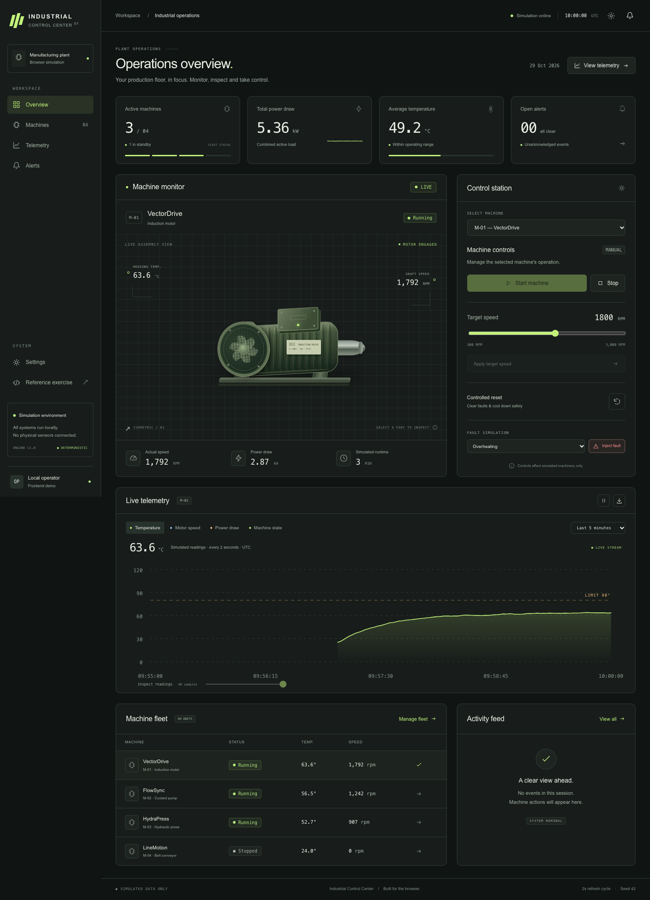
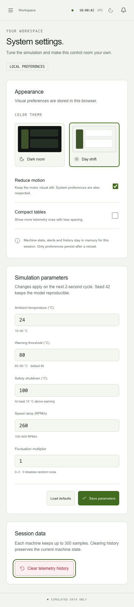

# Industrial Control Center

**Interactive Industrial Monitoring Dashboard**

[](https://github.com/revyalo/industrial-control-center/actions/workflows/ci.yml)

[Open the application](https://revyalo.github.io/industrial-control-center/#/dashboard) · [Explore the reconstructed foundation](https://revyalo.github.io/industrial-control-center/#/foundation) · [Public verification runs](https://github.com/revyalo/industrial-control-center/actions/workflows/ci.yml)

A fully browser-based Angular workspace for monitoring and controlling a simulated machine fleet. Inspect an animated motor assembly, explore reactive telemetry, inject faults and follow controlled recovery. No backend, external database, account system or physical sensors are involved.

Industrial Control Center is an independent frontend portfolio product. It develops a small reconstructed technical exercise into a multi-machine monitoring workspace, with its own simulation engine, visual system, analytics, accessibility and delivery pipeline. No source from the previous Angular 20 project is included.

## Origin and scope

| Area                                                                              | What it demonstrates                                                                                                                                                                                                    |
| --------------------------------------------------------------------------------- | ----------------------------------------------------------------------------------------------------------------------------------------------------------------------------------------------------------------------- |
| **Reconstructed foundation** — `/#/foundation`                                    | A fresh implementation of the basic ACTIA Systems technical brief: `MachineState`, an RxJS `MachineService`, `MachineDashboard`, `TelemetryDisplay`, `ControlPanel`, start/stop, CSS motor and 2-second telemetry.      |
| **Independent product development** — `/#/dashboard` and the other feature routes | Subsequent work: multi-machine simulation, progressive RPM, warnings and recovery, interactive machinery, SVG analytics, CSV, configurable parameters, themes, responsive UI, accessibility, automated tests and CI/CD. |

The basic exercise was reconstructed from its written requirements because no original source was available. This project does not claim to recover the lost implementation. The expanded product is subsequent independent work, not an official company product. The private source PDF and company assets are not published.



## Features

- Four seeded simulated machines with RUNNING, STOPPED, WARNING and ERROR states.
- Live KPIs, progressive RPM changes, thermal behavior, power draw and simulated runtime.
- Original HTML/CSS motor with a speed-driven fan, LEDs and selectable parts.
- Temperature, RPM, power and state SVG charts with time ranges, pointer tooltips, keyboard inspection and view pause.
- Bounded telemetry histories retained across navigation and explicitly labelled CSV exports.
- Start, stop, target speed, overheat/mechanical fault injection, reset and controlled cooling.
- Event filters by severity, machine and review status; acknowledgement is independent of fault recovery.
- Validated simulation parameters, dark/light themes, reduced motion and compact tables.
- An isolated **Reference exercise** route retaining the original functional contract.

## Stack

Angular **22.2.3**, Angular CLI **22.2.5**, TypeScript **6.0.3** with strict templates and `noUncheckedIndexedAccess`, standalone components, Signals, RxJS **7.8.2**, Angular Router, semantic HTML, project-owned CSS/SVG, Vitest **5.0.5**, Playwright **1.64.1** and axe-core.

There are no CSS frameworks, component kits, charting libraries or runtime third-party network dependencies. Compatible Node versions follow [Angular's official compatibility table](https://angular.dev/reference/versions).

## Run locally

Use Node **24.21.0** (also recorded in `.nvmrc`) and npm. From this project folder:

```sh
npm ci
npm start
```

Open **http://localhost:4200/#/dashboard**. Hash routing supports static hosting and direct route links. The UI is in English; the isolated reference controls retain “Iniciar” and “Detener”.

## Quality checks

```sh
npm test                     # Vitest unit and Angular component tests, one run
npm run test:watch           # Interactive unit-test watch mode
npm run check                # Formatting + strict TypeScript + preview syntax
npm run build                # Production build for a root static host
npm run build:pages          # Production build with /industrial-control-center/ as the base
npx playwright install chromium
npm run test:e2e             # Test the built Pages artifact; run build:pages first
npm run test:e2e:report      # Open the latest HTML test report
```

On macOS 13 the current Playwright Chromium download is unsupported. Use an installed Google Chrome instead:

```sh
npm run build:pages
E2E_CHANNEL=chrome npm run test:e2e
```

The tests use a seeded engine, virtual timers where appropriate and an installed Playwright clock in browser scenarios. They verify startup, telemetry, stop, overheating, alerts, mechanical faults, recovery, machine switching, history lifetime, CSV, configuration validation, mobile navigation, theme persistence and keyboard dialog behavior. **Publicly verified:** [20 unit/component tests and 11 E2E tests passed in GitHub Actions](https://github.com/revyalo/industrial-control-center/actions/runs/40861233480), followed by successful Pages deployment and a real-browser check of the public application. All 11 E2E also passed independently against the public URL. See [verification results](docs/VERIFICATION.md) for the executed checks and limitations.



## Architecture

```text
SimulationEngine (pure TypeScript + seeded randomness)
       ↓ explicit timestamps and commands
FleetStore (RxJS source → Signals → computed projections)
       ↓ immutable inputs and explicit output events
Lazy feature views + project-owned UI components
```

[Architecture and decisions](docs/ARCHITECTURE.md) explains state ownership, cooling transitions, bounded storage and rendering. [Reconstruction scope](docs/RECONSTRUCTION.md) distinguishes the reference requirements from new product capabilities. [Milestones](docs/MILESTONES.md) records incremental validation.

## Simulator

All values are generated in the browser. Each session starts with three simulated minutes of warm-up history and a fixed seed of 42. Three machines begin running and one is stopped. Changes are sampled every two seconds; up to 300 readings per machine and 100 events are retained.

Temperature approaches a simplified speed-dependent equilibrium. Power follows an illustrative quadratic model. Overheating raises the thermal load until a warning or automatic shutdown occurs; mechanical faults stop immediately. Reset clears the fault, then cools a hot machine before enabling manual start. Acknowledging an alert never restarts or repairs a machine.

A paused chart freezes only its view. The underlying simulation continues. Browser background throttling is deliberately not treated as precise industrial time. This simulator is an educational model, not an engineering or safety-control tool.

## Design and accessibility

The original interface uses restrained graphite surfaces, lime operational accents, distinct text-labelled warning/error states, CSS custom properties and responsive Grid/Flexbox layouts. Dark and light palettes share the same semantic tokens. Components are authored without a UI library.

Keyboard access, visible focus, a skip link, native modal behavior, labelled form controls, chart inspection and reduced-motion preferences are built in. Automated axe checks cover all six routes in both themes. Manual assistive-technology testing remains a release follow-up; automated checks do not establish complete WCAG conformance.

## CI/CD and GitHub Pages

The public application is served at **https://revyalo.github.io/industrial-control-center/**. Its two entry points are:

- Product: [`/industrial-control-center/#/dashboard`](https://revyalo.github.io/industrial-control-center/#/dashboard).
- Reconstructed exercise: [`/industrial-control-center/#/foundation`](https://revyalo.github.io/industrial-control-center/#/foundation).

`npm run build:pages` sets Angular's base href to `/industrial-control-center/`. Angular Router uses hash navigation, so direct feature links and browser refreshes do not require server rewrite rules. `npm run preview:pages` serves that exact build locally, under the same repository subpath.

The [Frontend quality and Pages workflow](.github/workflows/ci.yml) runs on pull requests, pushes to `main` and manual dispatch:

1. Install the recorded Node and npm versions, then restore dependencies with `npm ci`.
2. Check formatting, strict TypeScript and the local test server's syntax.
3. Execute unit/component tests, build the optimized Pages artifact, and run Playwright/axe on that artifact at the repository subpath.
4. Retain browser reports and screenshots as workflow artifacts.
5. Only after verification succeeds, deploy that same artifact to GitHub Pages on `main`. Pull requests do not deploy.
6. Open the public deployment in a real browser and repeat the dashboard start/stop smoke test.

Official GitHub Actions are pinned to verified commit SHAs. Deployment permissions are restricted to the deployment job. Build output, dependencies, reports, local credentials and the private reference document are excluded from source control.

[Public Actions runs](https://github.com/revyalo/industrial-control-center/actions) provide the execution logs and downloadable browser reports. The [verification report](docs/VERIFICATION.md) distinguishes completed local checks from public release verification.

## Portfolio evolution

**Industrial Control Center** is the principal Angular 22 project, focused on simulation, observability and frontend engineering. [**NEXUS Machine Dashboard**](https://github.com/revyalo/machine-dashboard) is the earlier Angular 20 project, retained separately as evidence of progression. Its commits and source are not imported into this repository. After the new project was deployed and verified, the earlier repository was archived as a public, read-only record. Its code, default branch and commit history were preserved.

## Limitations

- Machine state and telemetry reset on page reload; only validated preferences persist.
- Histories and events are intentionally bounded, and old samples are discarded.
- Simulated power and temperature are illustrative, not calibrated physical models.
- Runtime charts and machine states are session-local; there is no cross-tab coordination.
- Automated browser tests target Chromium/Chrome. Firefox, Safari and manual assistive-technology checks remain separate follow-up work.
- Public execution evidence is linked above; full manual accessibility and field-device performance audits are not claimed.
